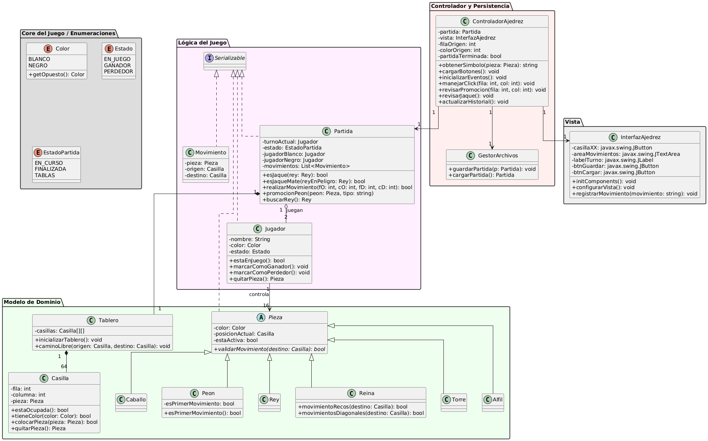

Este proyecto implementa un sistema de ajedrez completo en Java, aplicando los principios de la **Programación Orientada a Objetos (POO)**. El sistema permite gestionar partidas entre jugadores, validar reglas del juego, registrar movimientos y mantener la persistencia del estado de cada partida.

## Arquitectura

El sistema ha sido estructurado siguiendo el patrón de diseño **Modelo-Vista-Controlador (MVC)**, lo cual permite una separación clara entre la lógica del juego (Modelo), la interfaz gráfica (Vista) y la gestión de eventos y flujo de datos (Controlador).

## Herramientas y Tecnologías

- **Lenguaje:** Java 24 ([Descargar JDK](https://www.oracle.com/java/technologies/javase/jdk24-archive-downloads.html))
- **IDE:** NetBeans 26 ([Descargar](https://netbeans.apache.org/front/main/download/nb26/))
- **Control de Versiones:** Git y GitHub
- **Modelado UML:** Draw.io (Diseño inicial) y PlantUML (Diagrama final)

## Diagrama UML

## Guía de Instalación y Ejecución

### 1. Clonar el repositorio

1. Dirígete a la página principal del repositorio en **GitHub**.
2. Haz clic en el botón verde **Code** ubicado en la parte superior derecha de la lista de archivos.
3. Selecciona **Download ZIP** para descargar el código fuente comprimido, o copia la URL proporcionada si prefieres utilizar un cliente de Git para clonar el repositorio.

### 2. Abrir el proyecto en NetBeans

1. Abre **Apache NetBeans 26**.
2. Ve al menú superior **File > Open Project...**
3. Navega hasta la carpeta donde descargaste el repositorio.
4. Selecciona la carpeta del proyecto (identificada por el icono de carpeta de proyecto de NetBeans).
5. Haz clic en **Open Project**.

### 3. Ejecución

* Una vez cargado, NetBeans analizará las dependencias automáticamente.
* En el panel **Projects**, haz clic derecho sobre el proyecto.
* Selecciona la opción **Run** para compilar y ejecutar el código.
* El sistema iniciará automáticamente la interfaz gráfica del juego.
