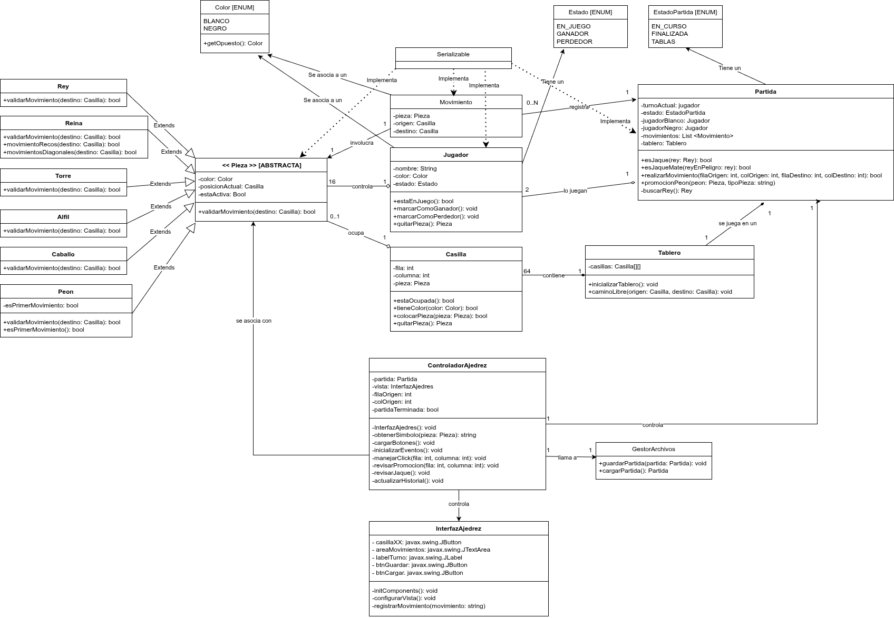

Con este proyecto se buscó implementar un sistema de ajedrez en Java que permita gestionar partidas entre jugadores, controlar las reglas del juego, registrar los movimientos realizados y administrar el estado completo de cada partida.

## Informacion tecnica

- IDE: Netbeans 26 [**[DESCARGA]**](https://netbeans.apache.org/front/main/download/nb26/)
- Version de java: Java 24 [**[DESCARGA]**](https://www.oracle.com/java/technologies/javase/jdk24-archive-downloads.html)

## UML

